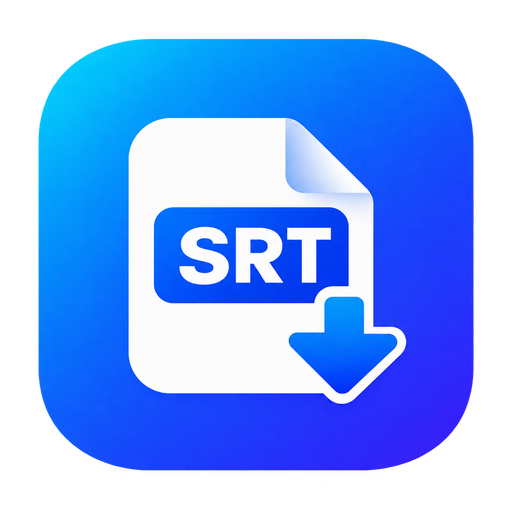

<div align="center">



# 剪映 SRT 字幕导出工具
### JianYing Subtitle Exporter

> **为剪辑师与创作者打造的轻量辅助小工具：无需开通剪映 VIP，一键秒级提取并导出剪映识别字幕为标准 `.srt` 文件或纯文本。**

[](https://github.com/DQTX760)
[](https://www.python.org/)
[](LICENSE)
[](https://github.com/DQTX760)

</div>

---

## 💡 为什么需要这个小工具？

剪映的**智能语音转文字**（智能字幕）对中文口语、断句、专业词汇的识别准确率极高，是许多视频博主的首选。

但在剪映升级到 **6.0+（包含 6.1 及以上）** 后，官方做出了两项限制：
1. **字幕导出被锁入 VIP 限制**：导出纯字幕需要付费会员，否则必须花费大量时间去完整渲染成片。
2. **草稿文件进行了强加密**：本地草稿 `draft_content.json` 变为密文乱码，导致市面上早期的老工具全军覆没、报错崩溃。

**本工具正是为解决此痛点而开发**：完美兼容剪映高版本加密草稿，在剪映完成语音转文字后，**点一下就能直接获取标准 `.srt` 字幕文件，秒级完成！**

---

## ✨ 核心特性

* ⚡ **一键导出标准 SRT**：自动关联打轴时间戳与文字内容，毫秒级在指定目录生成 `.srt` 文件。
* 📋 **一键复制台词文本**：省去打开文本文件的麻烦，点击按钮直接将全篇台词复制到剪贴板，方便直接粘贴发给 AI / Agent 生成分镜或视频特效包装。
* 🔓 **深度适配剪映 6.0+ 加密草稿**：底层集成开源草稿解密引擎，完美支持剪映 6.0、6.1 及最新版本，告别 `Unexpected token` 报错。
* 🛡️ **内存临时沙箱解密**：每次解密均在系统临时文件夹中进行，提取后瞬间自动销毁明文，**绝不修改、污染你原本的剪映工程**。
* 📁 **自由修改导出位置**：右上角提供【导出路径】设置，默认导出至桌面，也支持自由配置保存至任意工作文件夹。
* 🪶 **0 第三方依赖（Zero Dependencies）**：纯原生 Python 标准库编写，**不需要执行繁琐的 `pip install`**，解压即可运行。
* 🖥️ **深色极简原生 UI**：启动自动在屏幕正中央居中显示，配备轻量交互悬浮提示，不打断剪辑思路。

---
## 🤖 AI Agent 联动工作流（MCP + Skill 双驱使用步骤）

> 💡 **核心逻辑：光安装技能是没有用的，必须先配置 MCP！**
> - **第一步：配置 MCP（安装手脚）** ➔ 赋予智能体直接读取、解密、加密写回剪映底层草稿的操作系统能力；
> - **第二步：安装 Skill（安装大脑）** ➔ 教会智能体专业剪辑师的审美标准与断句排版规则；
> - **第三步：直接在对话中调用** ➔ 一句话让智能体驱动剪映自动完成字幕优化与动效音效包装。

---

### 第一步：配置 MCP 服务（赋予智能体操作剪映的底层能力）

1. **安装环境依赖**：
   在本项目根目录下打开终端运行：
   ```bash
   pip install -r requirements.txt
   ```
2. **本地快速自检**：
   双击运行文件夹内的 **`测试MCP服务.bat`**（或在命令行运行 `python mcp_server.py --test`）。  
   看到 `测试通过！` 即说明环境已完全具备，成功读取到剪映本地草稿。

3. **在你的 AI 客户端中挂载 MCP**：
   在 Claude Desktop、Claude Code、Cursor、Windsurf、Codex 或 WorkBuddy 的 MCP 配置文件（如 `claude_desktop_config.json` 或 `mcp.json`）的 `mcpServers` 节点中添加：

   ```json
   {
     "mcpServers": {
       "jianying-subtitle": {
         "command": "python",
         "args": [
           "D:\\你的项目路径\\SubExport\\mcp_server.py"
         ]
       }
     }
   }
   ```
   *(注：请将上述路径替换为你电脑上实际克隆 `SubExport` 项目的绝对路径)*

---

### 第二步：安装配套 Skill 技能（赋予智能体黄金排版与校对思维）

本项目已将经过长期实战打磨的剪辑师技能完整内置在 **`skills/`** 目录下：

1. **Claude Code 用户**：
   将 `skills/jianying-subtitle-optimizer` 复制或软链至 `~/.claude/skills/`：
   ```powershell
   # Windows PowerShell 示例
   Copy-Item -Recurse "skills\jianying-subtitle-optimizer" "$HOME\.claude\skills\"
   ```
2. **Codex 用户**：
   将 `skills/jianying-subtitle-optimizer` 复制或软链至 `~/.codex/skills/`：
   ```powershell
   Copy-Item -Recurse "skills\jianying-subtitle-optimizer" "$HOME\.codex\skills\"
   ```
3. **其他智能体 / 网页端 / 自定义系统提示词**：
   直接将 `skills/SKILL.md` 的内容复制作为系统 Prompt 或工作流知识库规则。

---

### 第三步：在对话中直接调用（一句话全自动）

完成上述两步后，只需在剪映中完成语音识别转字幕，然后切回你的 AI 客户端直接对话：

- **方式 1（全自动极速模式，最常用）**：
  > **“帮我校对剪映最新草稿字幕”**
  > 或 **“优化剪映字幕”**

- **方式 2（指定台词或斜杠命令）**：
  > **`/jianying-subtitle-optimizer [附带你导出的台词文本]`**

智能体将自动驱动 MCP 服务在 **5 秒内** 完成以下全部动作：
1. 自动定位最新草稿并释放剪映文件锁；
2. 纠正错别字、清除无意义口语碎词、长句按语义优雅分行（<=8字）；
3. 注入经典排版：**Aa研宋体 (13.0) + 60% 立体阴影 + 核心词放大16.5亮黄高亮**；
4. 自动锁定竖屏黄金安全区 **`y = -0.42`**（完美避让抖音章节横条与文案上浮）；
5. 自动在关键转折点注入 5~8 处轻动效与卡点音效，人声标准化增益至 **+7.0 dB**；
6. 原地加密写回剪映工程并自动重载，新效果即刻呈现在剪映中！

---

### 附：MCP 提供的核心工具列表

| MCP 工具名称 | 对应功能 | 价值 |
|---|---|---|
| **`one_click_optimize_subtitles`** | 5秒一键极速优化通道 | 1步端到端完成校对+排版+动效+音效 |
| **`get_latest_draft_subtitles`** | 自动提取剪映最新草稿全部字幕 | 零手动复制，秒级获取全量台词与时间戳 |
| **`update_draft_subtitles`** | 校正文字 + 注入样式 + 安全写回 | 保持打轴时码绝对不变，支持研宋体阴影样式 |
| **`export_draft_to_desktop`** | 纯导出留档 | 提取当前草稿的 TXT 与 SRT 保存至桌面 |
| **`list_recent_drafts`** | 列出剪映最近草稿 | 支持挑选历史项目进行精准处理 |
| **`restore_draft_backup`** | 从 `.bak` 一键撤销还原 | 零风险安全底线 |
| **`search_jianying_assets`** | 离线检索特效/转场/动画/音效/BGM | 支持中文模糊检索剪映全量官方素材库 ID |
| **`add_audio_sfx_or_bgm`** | 一键添加音效或背景音乐 | 自动处理节拍/声道/变速引用，内置常用卡点音效 |
| **`apply_smart_zoom`** | 关键帧智能平滑运镜变焦 | 类似 FocuSee / Ken Burns 视觉放大特写 |


## 🚀 快速上手指南（给朋友的使用说明）

### 第一步：确认电脑安装了 Python
本工具基于 Python 运行（无需额外配置复杂环境）：
* 如果电脑已安装 Python（版本 3.8 或更高均可），直接进入第二步。
* 如果尚未安装，请前往官网下载安装：[Python 官方下载页](https://www.python.org/downloads/)  
  *(⚠️ **关键注意**：安装第一步时，务必在窗口底部勾选 **`Add python.exe to PATH`**！)*

---

### 第二步：下载本项目
点击本页面绿色的 **`Code`** 按钮 ➔ **`Download ZIP`**，将压缩包解压到你电脑的任意文件夹中。

---

### 第三步：日常使用（推荐创建桌面快捷方式）

1. **创建桌面快捷图标（只需做一次）**：
   * 进入解压后的文件夹，双击运行 **`创建桌面快捷方式.bat`**。
   * 你的桌面上会自动生成一个名为 **`剪映SRT字幕导出`** 的快捷方式（自带工具专属图标）。
   
2. **平时常规剪辑流程**：
   * **在剪映中**：导入视频，点击【文本】➔【智能字幕】完成语音识别。
   * **打开本工具**：在桌面上双击打开 **`剪映SRT字幕导出`**（自动居中弹出）。
   * **一键导出**：
     * 左侧草稿列表会自动选中最新修改的草稿，右侧能实时预览台词与时间轴。
     * 点击右下角 **【⚡ 导出字幕】**（或直接在左侧列表**双击该草稿**），字幕文件立即生成！
     * 点击 **【📋 复制文本】**，所有台词直接复制到剪贴板。

---

## 🖥️ 界面功能速览

```text
┌────────────────────────────────────────────────────────────────────────┐
│ 🎬 剪映SRT字幕导出          [作者 GitHub]   [🔄 刷新草稿]   [📁 导出路径] │
├──────────────────────────┬─────────────────────────────────────────────┤
│ 本地剪映草稿             │ 预览: 10月22日                   共 19 条字幕 │
│ ┌──────────────────────┐ │ ┌─────────────────────────────────────────┐ │
│ │ 项目名称    修改时间 │ │ │ [01] 00:00:00,266 → 00:00:01,000        │ │
│ │ 10月22日  10-22 22:41│ │ │      大家好                             │ │
│ │ 10月19日  10-19 15:30│ │ │                                         │ │
│ │ 10月18日  10-18 23:12│ │ │ [02] 00:00:01,000 → 00:00:02,766        │ │
│ └──────────────────────┘ │ │      我来做一个测试                     │ │
│                          │ └─────────────────────────────────────────┘ │
├──────────────────────────┴─────────────────────────────────────────────┤
│ 💡 导出位置: 桌面 (双击草稿直接导出)             [📋 复制文本]  [⚡ 导出字幕] │
└────────────────────────────────────────────────────────────────────────┘
```

---

## 🎯 常见使用场景

1. **不想开通 VIP 的视频剪辑创作者**：剪映自动打轴又准又快，直接导出 `.srt` 用于 Premiere、Final Cut Pro、达芬奇或各大自媒体发布后台。
2. **AI / Agent 自动化包装工作流**：将录屏/口播视频导入剪映一键转文字后，直接复制文本或导出字幕给 AI Agent，驱动 Agent 自动计算时间轴制作动画与特效包装。
3. **文稿与会议纪要整理**：会议或演讲视频拖入剪映转文字后，点一下【复制文本】，瞬间获取排版干净的文字稿。

---

## ❓ 常见问题 (FAQ)

#### Q1：双击 `启动软件.bat` 闪退或者提示未检测到 Python？
* 出现这种情况通常是因为安装 Python 时没有勾选环境变量。
* 重新运行 Python 安装包，选择“Modify”，并勾选 `Add python.exe to PATH` 即可。

#### Q2：为什么列表显示“无字幕”或“未检测到语音识别字幕”？
* 请先确认已在剪映中点击了【文本】➔【智能字幕】完成了识别，并且剪映已经保存了工程（识别完后随手切一下剪映窗口即可自动保存）。
* 随后点击本工具右上角的 **【🔄 刷新草稿】** 即可同步出现。

#### Q3：导出的字幕文件保存在哪里？
* 默认保存在当前 Windows 用户的**桌面**。
* 如果需要保存到其他位置，点击右上角的 **【📁 导出路径】** 即可自由修改。

---
## 🛠️ 开发者二次开发与 EXE 编译指南

本项目桌面端完全开源（基于原生 Python + Tkinter 实现），无任何第三方 GUI 框架的臃肿负担。如果你希望对桌面软件进行二次开发（如扩展字幕格式、定制专属样式、改进界面交互等），并重新打包为绿色单文件 `.exe` 分发给他人使用，可遵循以下流程：

### 1. 源码开发与实时调试
直接运行 `app.pyw` 即可启动原生桌面开发窗口（免控制台黑框）：
```bash
python app.pyw
```
- **核心源码文件**：
  - `app.pyw`：桌面客户端全部 GUI 交互、工程扫描与字幕时间戳解析；
  - `bin/jy-draftc.exe`：本地草稿临时解密核心二进制；
  - `icon.ico` / `icon.png`：专属软件图标资产。

### 2. 一键编译打包为单文件 EXE
项目中已提供配置好全部打包参数的 **`编译打包.bat`** 脚本：
- **方式 A（一键脚本）**：直接在根目录下双击运行 **`编译打包.bat`**；
- **方式 B（命令行手动执行）**：
  ```bash
  # 1. 安装 PyInstaller 打包工具
  pip install pyinstaller

  # 2. 执行编译命令（单文件、无黑框、内嵌图标与解密引擎）
  pyinstaller -w -F -i icon.ico --add-binary "bin/jy-draftc.exe;bin" app.pyw -n "剪映SRT字幕导出"
  ```
打包完成后，独立可执行程序将生成于 **`dist/剪映SRT字幕导出.exe`**，可直接发给没有安装 Python 环境的普通用户双击运行！

---


## 🤝 致谢与声明

* 核心解密模块借力于开源社区的优秀成果：感谢 [wenshui330/jy-draftc](https://github.com/wenshui330/jy-draftc) 提供的剪映 Windows 端草稿处理方案。
* 本工具仅读取用户电脑本地生成的合法剪辑工程，全程在本地沙箱运行，不联网、不上传任何隐私数据，与字节跳动官方剪映/CapCut 无任何关联。

---

**⭐ 如果这个小工具帮到了你和你的朋友，欢迎在 GitHub 上点一个 Star 支持一下！**  
**作者主页**：[DQTX760](https://github.com/DQTX760)
